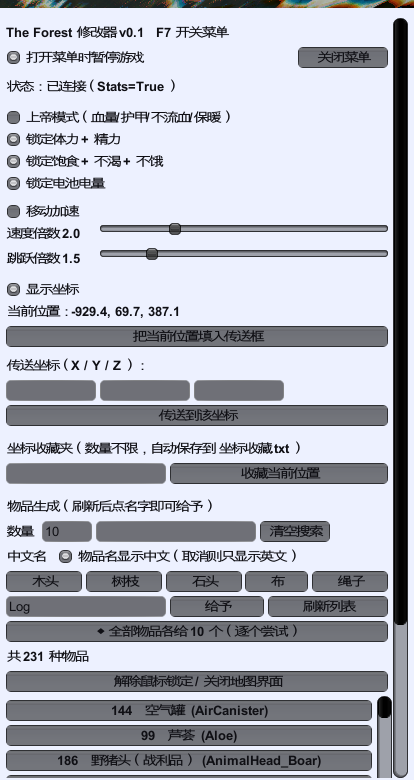

# The Forest Cheat Panel

**中文** | [English](#english)

《森林》(The Forest) 的游戏内 F7 修改器面板 —— BepInEx 5 插件。



> 非官方项目，与开发商 Endnight Games 无任何关联。仅供单机自用/学习交流。

## 功能

- **F7 呼出面板**，窗口可拖动、实心亮色底板
- **上帝模式**：血量/护甲拉满、不流血、不感冒、不掉体温、落地无伤
- **状态锁定**：体力、精力、饱食、不渴、不饿、电池电量
- **移动加速**：速度倍数、跳跃倍数可调
- **坐标系统**：实时显示 `X / Y / Z`，可直接输入坐标传送
- **坐标收藏夹**：数量不限、自定义命名、自动保存到 `BepInEx\config\坐标收藏.txt`
- **物品生成**：
  - 自动读取游戏物品数据库（231 种物品），**带中文名显示**（`原木 (Log)`、`现代斧 (AxeModern)`）
  - 搜索框支持中英文混搜（输「斧」「箭」都能筛出来）
  - 输入框可直接打中文，自动反查英文 id
  - 「全部物品各给 N 个」一键批量
  - 物品清单导出到 `BepInEx\config\物品清单.txt`

## 原理

- 游戏是 **Unity 5.6.5 + Mono 2.0** 后端，通过 **BepInEx 5** 注入
- 全部通过**反射**访问 `TheForest.Utils.LocalPlayer` / `PlayerStats` /
  `PlayerInventory` / `ItemDatabase`，不硬编码偏移，不修改游戏文件
- 编译时必须使用**游戏自带的 .NET 3.5 程序集**（`/nostdlib+` 引用
  `TheForest_Data\Managed\mscorlib.dll`），否则 `AddComponent` 会静默失败、
  面板永远不出现（这是本项目踩过的最大坑，详见 `build.ps1` 注释）

## 安装

1. 先安装 **BepInEx 5.4.23+ (x64)** 到游戏根目录（Steam → 右键游戏 → 管理 → 浏览本地文件）
   - 装好后游戏目录会出现 `winhttp.dll` 与 `BepInEx\core`
   - ⚠️ 游戏启动时会弹「TheForest Configuration」窗口，**必须点 Play** 才会注入
2. 把 `ForestCheat.dll` 放到：
   ```
   <游戏目录>\BepInEx\plugins\ForestCheat.dll
   ```
3. 启动游戏 → 进入存档 → 按 **F7**

## 自行编译

需要 .NET Framework 4.x 的 `csc.exe`（Windows 自带）和已装 BepInEx 的游戏目录。

```powershell
powershell -ExecutionPolicy Bypass -File .\build.ps1 -Install
# 或指定游戏目录
powershell -ExecutionPolicy Bypass -File .\build.ps1 -GameDir "D:\SteamLibrary\steamapps\common\The Forest" -Install
```

编译产物：`bin\ForestCheat.dll`

## 数据文件

全部位于 `<游戏目录>\BepInEx\config\`：

| 文件 | 说明 |
|---|---|
| `坐标收藏.txt` | 收藏的地点（名称 + X/Y/Z，可直接编辑） |
| `物品清单.txt` | 从游戏导出的物品 ID 与名称对照，首次刷新列表时生成 |
| `物品中文对照.txt` | 想改某个物品的中文叫法就在这里加一行 `英文名<TAB>中文名`，重启游戏生效 |

> 231 种物品的中文名已**内置在代码里**，开箱即用；这个 txt 只是可选的覆盖/扩展。

调试日志：`<游戏目录>\BepInEx\forestcheat_diag.txt`

## 排错

| 现象 | 处理 |
|---|---|
| F7 没反应 | ① 启动器窗口是否点了 **Play**？② 看 `BepInEx\LogOutput.log` 是否有 `Loading [Forest Cheat ...]`；③ 看 `forestcheat_diag.txt` 有没有 `Awake` |
| 面板出现但物品列表为空 | 需要先进入存档（物品数据库读档后才初始化），然后点「刷新列表」 |
| 给了物品后鼠标卡住 | 旧版本会因自动装备锁视角，现已用 `preventAutoEquip=true` 修复；若仍出现，点面板的「解除鼠标锁定」 |
| 全部物品里有给不了的 | 部分任务物品 / 剧情道具无法直接进背包，属正常现象 |

## 注意

- 单机使用，联机请勿使用
- 大量刷物品可能导致存档臃肿，建议刷之前手动备份存档
  （`%USERPROFILE%\AppData\LocalLow\SKS\TheForest\`）

## 许可

MIT。BepInEx 为 LGPL-2.1，本项目仅依赖它，不包含其源码。

---

## English

In-game cheat panel for **The Forest** (Unity 5.6 / Mono), loaded by **BepInEx 5**.
Press **F7** in game.

- **God mode**: health, armor, no bleeding, no cold, no fall damage
- **Locks**: stamina, energy, fullness, thirst, starvation, battery
- **Movement**: speed & jump multipliers
- **Coordinates**: live XYZ readout, teleport to typed coordinates
- **Waypoints**: unlimited, custom names, persisted to `BepInEx\config\坐标收藏.txt`
- **Item spawning**: reads the game's `ItemDatabase` (231 items), ships with **built-in
  Chinese names**, bilingual search, "give every item" batch button, item list export

Everything is done through reflection against `LocalPlayer` / `PlayerStats` /
`PlayerInventory` / `ItemDatabase` — **no game files are modified or decompiled**.

> ⚠️ Build note: this game runs on the .NET 3.5 Mono profile. Compiling against the
> default .NET 4.x mscorlib makes `AddComponent` fail silently and the panel never shows
> up. `build.ps1` therefore uses `/nostdlib+` with the game's own `mscorlib.dll`.

### Install

1. Install **BepInEx 5.4.23+ (x64)** into the game root.
2. Copy `ForestCheat.dll` into `<GameDir>\BepInEx\plugins\`.
3. Launch the game, **click "Play" in the launcher dialog**, load a save, press **F7**.

### Build

```powershell
powershell -ExecutionPolicy Bypass -File .\build.ps1 -Install
```

### License

MIT. BepInEx is LGPL-2.1 and is only a dependency, not bundled with this project.
